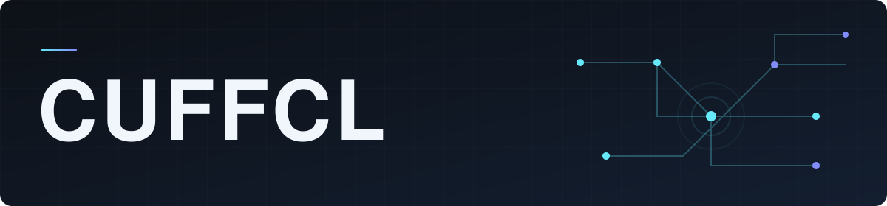

# Quinten / CUFFCL

**Software Developer · AI & Agents · Full-Stack · Game Development**

I build software across the stack, from application interfaces and backend services to developer tools and game systems. I'm interested in how thoughtful architecture turns complex ideas into useful, reliable software.

## Stack

**Languages** — Python · TypeScript · JavaScript · Java · HTML · CSS  
**Applications** — Node.js · PostgreSQL · REST APIs  
**Tools** — Git · GitHub · Docker

## Focus

- **AI & agent systems** — orchestration, tool use, and local LLM workflows.
- **Full-stack development** — clear interfaces, practical APIs, and dependable data flows.
- **Game development** — gameplay systems, server logic, and interactive experiences.

I care about readable code, clear boundaries, and software that behaves predictably.

---

[GitHub](https://github.com/CUFFCL) · [Public activity](https://github.com/CUFFCL?tab=overview)
